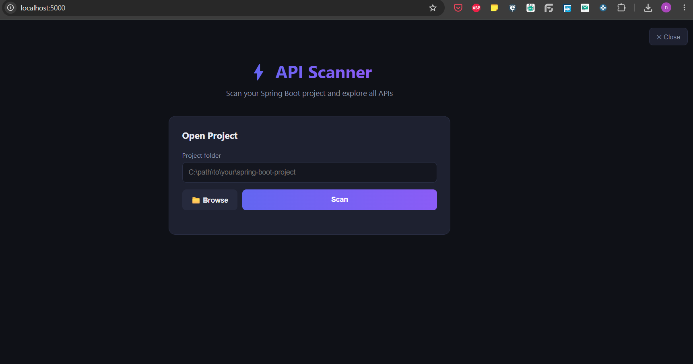
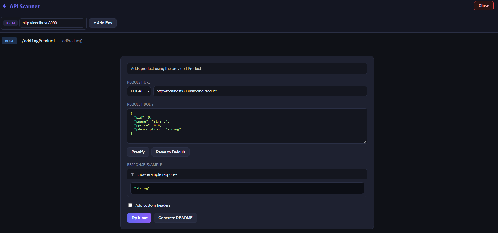

# ⚡ API Scanner

A lightweight desktop tool that scans **Java Spring Boot** projects and gives you a live, interactive API explorer in your browser — **no Swagger annotations and no running server required**.

Point it at a Spring Boot source folder and it statically analyzes your controllers, models, and services to discover every endpoint, auto-generate request and response examples, and let you fire real HTTP requests against any environment — all from a clean dark-themed UI.

> Built with Python + Flask on the backend and dependency-free HTML/CSS/JS on the frontend.

---

## Table of Contents

- [Why API Scanner](#why-api-scanner)
- [Screenshots](#screenshots)
- [Features](#features)
- [Requirements](#requirements)
- [Installation](#installation)
- [Usage](#usage)
- [How It Works](#how-it-works)
- [Supported Spring Patterns](#supported-spring-patterns)
- [Configuration](#configuration)
- [Project Structure](#project-structure)
- [Security Notes](#security-notes)
- [Troubleshooting](#troubleshooting)
- [Limitations](#limitations)

---

## Why API Scanner

Exploring the HTTP surface of a Spring Boot codebase usually means one of:

- Running the whole application (and its database, message brokers, etc.) just to open Swagger UI.
- Reading controllers by hand to figure out paths, payloads, and response shapes.
- Maintaining Swagger/OpenAPI annotations that drift out of sync with the code.

API Scanner skips all of that. It reads your `.java` source **directly from disk** and reconstructs the API surface through static analysis. You get an explorer comparable to Swagger UI, instantly, against code that may not even compile yet.

---

## Screenshots

> Screenshots are referenced from `docs/screenshots/`. Drop your own PNGs there with these names and they will render inline on GitHub. (Markdown can only *reference* images — the image files themselves must live in the repo.)

**Project picker**



**Dashboard — controllers & endpoints**


**Endpoint detail — payload, response example, and Try it out**



---

## Features

- **Static controller scanning** — discovers endpoints from `@RestController` / `@Controller` classes without running the app or requiring Swagger.
- **Auto-generated payloads** — builds realistic JSON request bodies from your `@RequestBody` (and Spring MVC `@ModelAttribute`) DTO types, including nested objects, collections, enums, and type-aware defaults.
- **Auto-generated responses** — infers response types from `ResponseEntity<T>`, direct returns, and service-layer return types, then renders example JSON.
- **Live "Try it out"** — sends real HTTP requests through a built-in backend proxy (sidesteps browser CORS), with status, timing, response body, and headers.
- **Environment switching** — define multiple base URLs (LOCAL, DEV, STAGING, ...) and flip any endpoint between them. URLs rebuild automatically as you edit path variables and query params.
- **Per-project overrides** — values you type into path variables, query params, and request bodies are remembered per project and per endpoint.
- **Postman export** — export the whole scan as a Postman Collection v2.1 file, with `{placeholders}` replaced by sensible default values.
- **README export** — generate a standalone HTML documentation page for any endpoint, including a cURL example and a Java `RestTemplate` snippet, optionally capturing a live test result.
- **Search & navigation** — filter by path, HTTP method, controller, or method name; expand/collapse controllers; open any endpoint in its own tab.
- **Self-contained dark UI** — no CDN, no external JS/CSS dependencies. Everything ships in the templates.

---

## Requirements

- **Python 3.9 or higher** (tested on 3.12). The minimum is driven by the pinned Flask version; the code itself uses only standard-library features plus Flask.
- **Tkinter** — used only for the native "Browse folder" dialog. It ships with the standard Python installers on **Windows** and **macOS**. On Linux install it via your package manager (e.g. `sudo apt install python3-tk`). If Tkinter is missing, the Browse button simply does nothing — you can always paste the folder path manually.
- A desktop environment (this is a local tool that opens a browser window).

Python dependencies (installed via `requirements.txt`):

| Package | Version | Purpose |
|---|---|---|
| `flask` | 3.0.3 | Web server and templating |
| `flask-cors` | 4.0.1 | Cross-origin handling for the local API |

Everything else (`os`, `re`, `json`, `threading`, `urllib`, `socket`, `ipaddress`, `subprocess`, `tkinter`, ...) is part of the Python standard library.

---

## Installation

```bash
# 1. Clone your repository
git clone <your-repo-url>
cd api-scanner

# 2. (Recommended) create a virtual environment
python -m venv .venv
# Windows
.venv\Scripts\activate
# macOS / Linux
source .venv/bin/activate

# 3. Install dependencies
pip install -r requirements.txt
```

---

## Usage

### Start the app

**Windows** — double-click `launch.bat`, or run:

```bash
python scanner.py
```

The server starts on port **5000** and your default browser opens to the project picker automatically.

### Scan a project

1. On the home page, click **Browse** to pick a Spring Boot project folder (or paste the path).
2. Click **Scan**. A progress bar shows files being processed.
3. When the scan finishes you are redirected to the **dashboard**.

### Explore and test

- Controllers are grouped in collapsible accordions; each endpoint is a card with a color-coded method badge and highlighted `{path variables}`.
- Click a card to expand it: edit path variables, query params, headers, and the request body. The request URL rebuilds live.
- Pick an environment (LOCAL by default) from the dropdown to switch base URLs.
- Click **Try it out** to send a real request through the proxy and inspect the response.
- Use **Generate README** to download standalone HTML docs for that endpoint, or **Export Postman** (top bar) to export the whole collection.

### Reset configuration

Run `reset.bat` (Windows) to restore `config.json` to clean defaults — handy before sharing the project or clearing recent paths.

### Change the port

Edit the **Port** field in the dashboard top bar and click **Restart**. The app relaunches on the new port and the page redirects to it automatically.

---

## How It Works

API Scanner is a static analyzer. It never executes your Java code — it reads and parses the source text.

### 1. File discovery

Walking the project tree (`os.walk`), it classifies directories by name and skips build/test output (`target`, `build`, `.git`, `node_modules`, `test`, etc.):

- **Controllers** — directories named `controller` / `controllers`.
- **Services** — `service` / `services` (the `impl` subfolder is skipped).
- **Models / DTOs** — a broad set of conventional names: `model`, `dto`, `domain`, `entity`, `request`, `response`, `payload`, `vo`, `bean`, `pojo`, `form`, and more.

### 2. Controller parsing

For each controller, a hand-written parser (not a naive `split`) walks the class body and, for every mapping annotation, extracts:

- The HTTP method (`@GetMapping` → GET, `@RequestMapping(method = ...)`, etc.) and the full path (class-level `@RequestMapping` base + method path, normalized).
- Parameters: `@PathVariable`, `@RequestParam` (honoring explicit `value=`/`name=`, never mistaking `defaultValue` for the name), `@RequestBody`, `@ModelAttribute`, and `@RequestHeader` (catch-all `Map` headers are ignored).
- The method body, used to infer return types and generate a human-readable description.

Parameter extraction uses **depth counting** on parentheses and angle brackets so that annotation arguments containing commas or parentheses (e.g. `@RequestParam(defaultValue = "a,b")`) parse correctly.

### 3. Model & service caches

- **Model cache** — maps each class to its `{field: type}` map, or to its enum constants. Field parsing only reads declarations at class-body depth, so statements inside getters/setters (like `return id;`) are never mistaken for fields.
- **Service cache** — maps service method names to their return types. It handles **both** service *interfaces* and concrete `@Service`/`@Component` *classes*, which lets response-type inference work even when a controller returns a view name or a generic wrapper.

### 4. Example generation

`build_example_json` turns a type name into example JSON, with a recursion guard against circular references:

- Collections (`List`/`Set`/`Collection`/`Page<X>`) → arrays of the inner type.
- `Map<...>` → `{"key": "value"}`.
- Primitives → type-aware defaults (`int` → `0`, `String` → `"string"`, `BigDecimal` → `"0.00"`, `LocalDateTime` → `"2024-01-15T10:30:00"`, `UUID` → a sample UUID, ...).
- Enums → the first constant.
- Known model classes → a recursively built object of their fields.

### 5. Serving & testing

The scan runs in a background daemon thread; the UI polls progress and then loads results. The **Try it out** proxy issues the real request server-side (avoiding browser CORS), enforces an SSRF safety check, and returns the status, body, headers, and elapsed time.

---

## Supported Spring Patterns

**Well supported (REST APIs):**

- `@RestController`, class- and method-level `@RequestMapping`.
- `@GetMapping` / `@PostMapping` / `@PutMapping` / `@DeleteMapping` / `@PatchMapping`.
- `@PathVariable`, `@RequestParam`, `@RequestBody`, `@RequestHeader`.
- `ResponseEntity<T>`, `ResponseEntity.ok(...)`, `new ResponseEntity<>(...)`, `.body(...)`, and direct object returns.
- Nested DTOs, `List`/`Set`/`Page` collections, enums, and common `java.time` / `java.util` types.
- Service interfaces **and** concrete service classes for return-type inference.

**Partially supported (Spring MVC / server-rendered apps):**

- `@ModelAttribute` form-bound parameters are treated as a request payload so you still get an example body.
- Endpoints that return a `String` view name are shown with that string as the response (there is no JSON body to infer). Any domain object the method touches via service calls is still surfaced where possible.

---

## Configuration

Configuration lives in `config.json` next to `scanner.py`:

```json
{
    "port": 5000,
    "last_project": "",
    "recent_projects": [],
    "urls": {
        "LOCAL": "http://localhost:8080"
    },
    "project_overrides": {}
}
```

| Key | Description |
|---|---|
| `port` | Port the local server listens on. |
| `last_project` | Path of the most recently scanned project. |
| `recent_projects` | Up to 10 recent project paths (most recent first). |
| `urls` | Named environments. `LOCAL` is always present and cannot be removed. |
| `project_overrides` | Per-project, per-endpoint saved values for path variables, query params, and request bodies. |

Most of this file is managed by the UI — you rarely edit it by hand. Run `reset.bat` to return it to the clean defaults above.

---

## Project Structure

```
api-scanner/
├── scanner.py              # Flask backend: parser, caches, routes
├── requirements.txt        # Python dependencies
├── config.json             # Runtime configuration (clean defaults)
├── launch.bat              # Windows launcher
├── reset.bat               # Resets config.json to defaults
├── .gitignore
├── README.md
└── templates/
    ├── index.html          # Project picker + scan progress
    ├── dashboard.html      # Main interactive API explorer
    ├── api_detail.html     # Single-endpoint view (opened in a new tab)
    └── readme_template.html# Standalone HTML export for a single endpoint
```

---

## Security Notes

API Scanner is a **local developer tool**. A couple of safety measures are built in:

- **SSRF protection** — the Try it out proxy allows `localhost` / `127.0.0.1` / `::1` but blocks other private, link-local, and reserved IP ranges, and non-HTTP(S) schemes. This prevents the proxy from being used to reach internal infrastructure.
- **Safe folder checks** — scanning is blocked for sensitive system directories (`C:\Windows`, `/etc`, `/bin`, `/proc`, ...).

Because it binds to a local port and can proxy requests, run it only on machines you trust and do not expose the port to untrusted networks.

---

## Troubleshooting

**The browser didn't open.** Visit `http://localhost:5000` manually. If the port is in use, change it in the dashboard (Port field → Restart) or edit `config.json`.

**"Browse" does nothing.** Tkinter may be unavailable. Paste the project path into the input instead, or install Tkinter (Linux: `sudo apt install python3-tk`).

**Scan finds no controllers.** Make sure you pointed at a folder that contains your controller package. Controller directories must be named `controller` / `controllers`.

**A response or payload is empty.** The endpoint may not use a JSON request/response (e.g. a Spring MVC view-returning method), or the DTO lives in an unrecognized folder. Move it under a conventional name (`model`, `dto`, `domain`, `entity`, ...) or open an issue.

**Try it out fails with a network/CORS warning.** The target server must be reachable from your machine. Remember the proxy blocks non-local private IP ranges by design.

---

## Limitations

- **Static analysis only.** It reads source text and cannot resolve everything a compiler would (complex generics, inheritance chains, annotation meta-programming, Lombok-generated accessors on fields it can't see, etc.). Generated examples are best-effort.
- **Spring-focused.** The directory and annotation conventions target Spring Boot / Spring MVC. Other frameworks are not supported.
- **Convention-dependent.** Discovery relies on standard package naming (`controller`, `service`, `model`/`dto`/`entity`, ...). Unconventional layouts may need those folders renamed to be detected.
